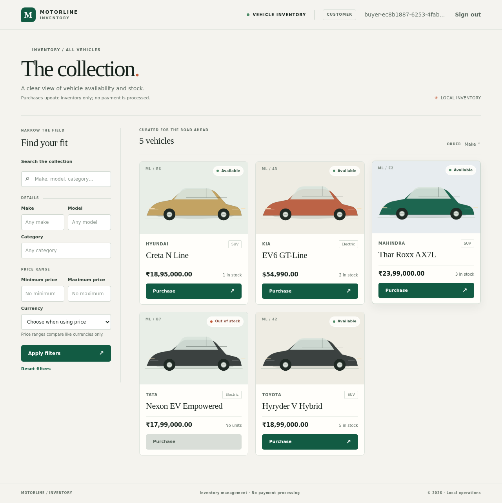
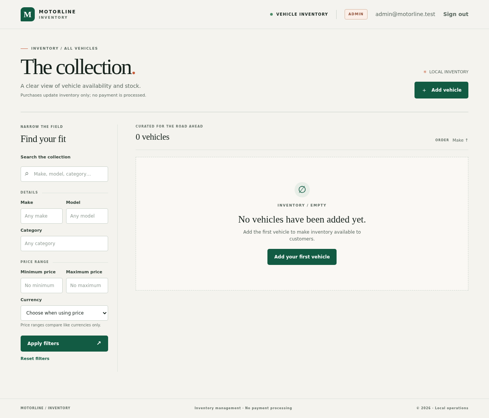
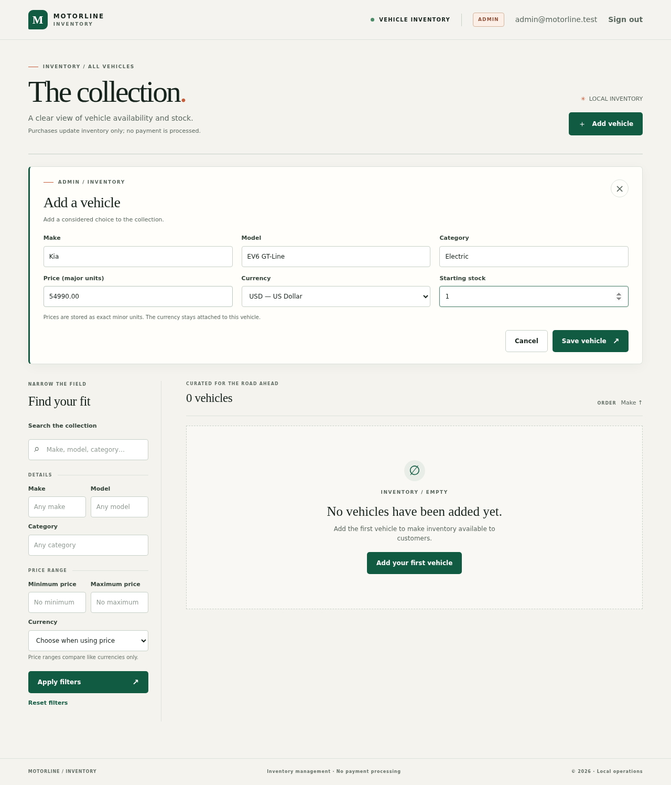
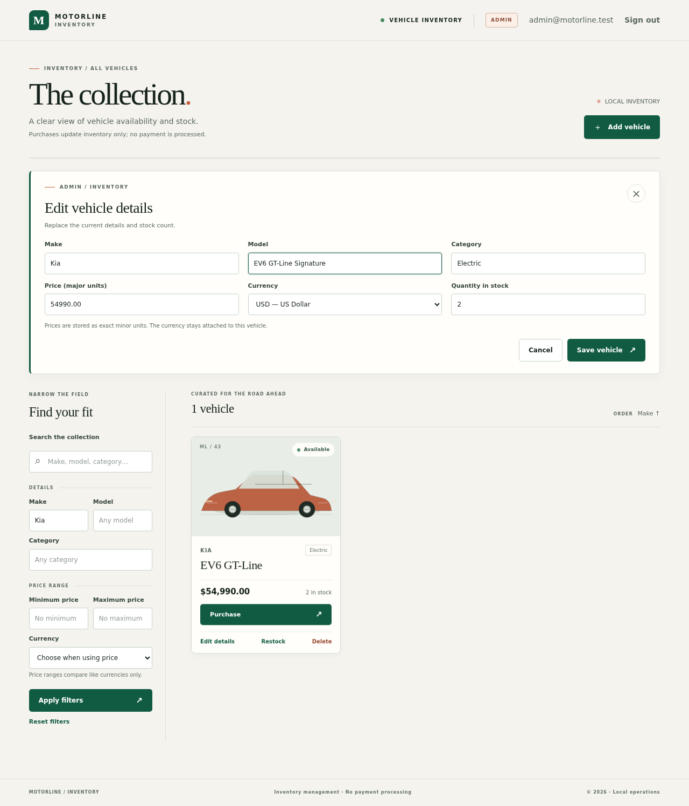
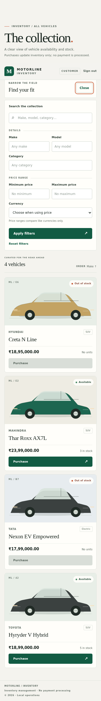
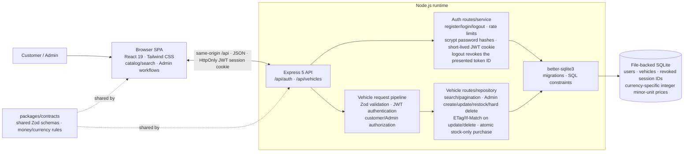

# Motorline Inventory

Motorline Inventory is a full-stack vehicle inventory application with a customer catalog and an Admin interface. It uses a React frontend, an Express API, and persistent SQLite storage.

## Live demo

**Try the hosted application:** <https://car-dealership-inventory-5i7b.onrender.com/>

| Role     | How to sign in                                                                     |
| -------- | ---------------------------------------------------------------------------------- |
| Admin    | Email: `admin@motorline.test` · Password: `motorline-admin-passphrase`             |
| Customer | Register your own account with any valid email and a password of 12–128 characters |

The demo runs on Render's free tier. The first request can take up to about a minute to wake the service after it has been idle. Its start command recreates a disposable demo database containing the Admin above and five synthetic vehicles whenever the free service restarts, redeploys, or wakes after spin-down, so demo accounts and inventory changes are temporary. This is an evaluation profile, not durable production hosting. A normal local installation starts empty and has no default account.

## Screenshots

| Customer inventory - desktop                                      | Admin - empty inventory                                                  | Admin - first vehicle form                                                 |
| ----------------------------------------------------------------- | ------------------------------------------------------------------------ | -------------------------------------------------------------------------- |
|  |  |  |

| Admin inventory editor                                        | Customer inventory - narrow mobile                             |
| ------------------------------------------------------------- | -------------------------------------------------------------- |
|  |  |

## Capabilities

- Customer registration and sign-in. Public registration always creates the `customer` role; role input is rejected.
- Short-lived signed JWT sessions in an `HttpOnly`, `SameSite=Strict` cookie (`Secure` in production). Each token has a unique ID, and logout revokes that presented token server-side without ending the user's other sessions.
- Authenticated, paginated catalog and Unicode case-insensitive search by free text, make, model, category, and price bounds.
- Each price has an ISO 4217 currency. Prices persist as integer minor units; price comparisons require the same explicit currency and never perform foreign-exchange conversion.
- One-unit purchase requests make a conditional, atomic stock decrement. Zero-stock vehicles remain visible and cannot be purchased.
- Admin-only create, full update, restock, and hard delete, enforced at the API boundary as well as the UI. Updates/deletes use revision preconditions so stale Admin screens cannot overwrite/delete newer stock.
- File-backed SQLite migrations and constraints; no in-memory database or runtime dummy-data fallback.
- Responsive React/Tailwind SPA with loading, error, success, and distinct empty-catalog/empty-filter states; keyboard interaction and selected Axe checks.

## Stack

- **Runtime:** Node.js 22.20.0, npm 10.8+
- **API:** TypeScript, Express 5, Zod, JOSE, `better-sqlite3`
- **Web:** React 19, TypeScript, Tailwind CSS 4, Vite 8
- **Tests:** Vitest, Supertest, Testing Library, Playwright, Axe

This is an npm-workspaces monorepo: `apps/api`, `apps/web`, and shared validation/money contracts in `packages/contracts`.

## Architecture



## Local setup

### Requirements

- Node.js **22.20.0** (`.nvmrc`) and npm **10.8+**
- A platform supported by `better-sqlite3`

### First run

From the repository root:

```sh
npm ci
npm run setup          # writes an ignored .env with a fresh JWT signing secret
npm run db:migrate     # creates/migrates an empty local SQLite database
npm run admin:create   # one-time, interactive; password input is hidden
npm run dev
```

Open <http://localhost:5173>. The API listens on <http://localhost:3001>; Vite proxies `/api` to it. Sign in with the Admin you created and add the first vehicle through **Add vehicle**. For this local installation, no demo inventory is seeded and no default account or password is shipped; the public credentials above belong only to the disposable hosted demo profile. Public registration creates customers only; it cannot create an Admin.

`npm run admin:create` succeeds only while no Admin exists. It prompts for email/password without placing the password in shell history or command arguments. Subsequent Admins require a separately designed administrative process; this kata exposes no public role-promotion endpoint.

### Environment configuration

`npm run setup` creates `.env` with a cryptographically random signing secret and safe local defaults. `.env` and SQLite files are ignored by Git. Do not commit real secrets or database files. For manual configuration, copy `.env.example` to `.env`, replace `JWT_SECRET` with a random value of at least 32 bytes, and set the database path/port as needed. The example secret is deliberately rejected by the API.

| Variable              | Purpose                                                                   |
| --------------------- | ------------------------------------------------------------------------- |
| `NODE_ENV`            | `development`, `test`, or `production`; production enables secure cookies |
| `PORT`                | API port; defaults to `3001`                                              |
| `DATABASE_PATH`       | SQLite path, resolved from the repository root when relative              |
| `JWT_SECRET`          | Required signing key, at least 32 bytes; no runtime fallback              |
| `AUTH_RATE_LIMIT_MAX` | Login/register attempts per IP per 15-minute window; defaults to `10`     |
| `LOG_LEVEL`           | Reserved runtime setting (`error`, `warn`, `info`, `debug`)               |

### Build and production-style start

```sh
npm run build
NODE_ENV=production npm start
```

The build compiles the API and SPA. The API serves `apps/web/dist` and `/api` from one origin. Use HTTPS in any hosted environment so the production session cookie remains secure. Configure `JWT_SECRET`, `DATABASE_PATH`, and `PORT` through the host’s secret/configuration facility.

### Render Free demo profile

The live demo is one Render Free Web Service built from the repository root on the `main` branch:

| Setting           | Value                                                             |
| ----------------- | ----------------------------------------------------------------- |
| Build Command     | `npm ci --include=dev && npm run build`                           |
| Start Command     | `./node_modules/.bin/tsx apps/web/e2e/prepare-db.ts && npm start` |
| Health Check Path | `/api/health`                                                     |
| Auto-Deploy       | On Commit                                                         |

Set `NODE_ENV=production`, `NODE_VERSION=22.20.0`, `DATABASE_PATH=./apps/api/data/e2e.sqlite`, `AUTH_RATE_LIMIT_MAX=10`, and `LOG_LEVEL=info`. Generate a unique `JWT_SECRET` in Render and never commit it; do not set `PORT`, because Render provides it. The demo start command deliberately prepares the synthetic E2E database before starting the compiled server because Render Free has a disposable filesystem and no shell for the local first-Admin CLI. Do not use this profile where data must persist.

## API overview

All routes use `/api`. List/search requires an authenticated user. All inventory mutations are Admin-only, except the one-unit purchase operation, available to authenticated users.

| Method and path                   | Access | Purpose                                                    |
| --------------------------------- | ------ | ---------------------------------------------------------- |
| `POST /api/auth/register`         | Public | Register a Customer and start a session                    |
| `POST /api/auth/login`            | Public | Start a session                                            |
| `POST /api/auth/logout`           | Public | Revoke the presented session token and clear its cookie    |
| `GET /api/auth/me`                | User   | Return the current safe user DTO                           |
| `GET /api/vehicles`               | User   | Paged inventory, including zero-stock vehicles             |
| `GET /api/vehicles/search`        | User   | Search/filter the inventory                                |
| `POST /api/vehicles`              | Admin  | Add a vehicle; server generates its UUID                   |
| `PUT /api/vehicles/:id`           | Admin  | Replace all mutable fields; requires `If-Match` revision   |
| `DELETE /api/vehicles/:id`        | Admin  | Hard-delete with `If-Match`; returns `204`                 |
| `POST /api/vehicles/:id/purchase` | User   | Atomically decrement exactly one unit; request has no body |
| `POST /api/vehicles/:id/restock`  | Admin  | Add a positive whole-number stock quantity                 |

Session JWTs last one hour and include a unique token ID. Logout records a presented valid token ID as revoked until that token would have expired, then clears the cookie; a copied cookie or bearer token from that session is rejected, while other sessions for the same account remain valid. Logout remains idempotent with no, malformed, or expired token.

A vehicle has `id`, `make`, `model`, `category`, `price: { amount, currency }`, `quantity`, `version`, and timestamps. `amount` is a decimal string in major units at the API boundary; SQLite stores price as an integer in the currency’s minor units. New vehicles start at version 1; purchases and restocks increment the version as well as updates. `GET` responses include the current version; create/update responses also return a matching strong `ETag` from the origin and `Cache-Control: no-transform`. Some deployed intermediaries rewrite that validator to its weak spelling (for example, `W/"2"`), so Admin `PUT`/`DELETE` accept either spelling of one exact positive-integer revision as `If-Match`. Wildcards, lists, and non-numeric tags remain invalid. Missing preconditions return `428`, malformed values `400`, and stale writes `412 STALE_WRITE`; a stale full replacement cannot restore stock changed by a purchase.

Example search:

```text
GET /api/vehicles/search?q=electric&minPrice=20000.00&maxPrice=60000.00&currency=USD&page=1&limit=20
```

A price bound without `currency` is invalid. Search text is Unicode case-insensitive partial matching after compatibility (NFKC) normalization; `%`, `_`, and the escape character are treated literally rather than as SQL wildcards. Pagination defaults to 20 records and caps `limit` at 100. See [`docs/API_CONTRACT.md`](docs/API_CONTRACT.md) for exact request/status conventions and the role matrix.

## Tests and quality checks

```sh
npm run test:contracts
npm run test:api
npm run test:web
npm run test:unit       # all Vitest/Supertest suites
npm run test:e2e        # real API + Vite + Chromium journeys and Axe checks
npm run typecheck
npm run lint
npm run format:check
npm run coverage
npm run security:secrets # current-tree secret/data scan
npm run verify           # all of the above quality and security gates
```

Playwright needs Chromium and its Linux runtime libraries. On a fresh machine:

```sh
npx playwright install chromium
npx playwright install-deps chromium   # Linux only
```

The E2E setup creates an isolated file-backed database at `apps/api/data/e2e.sqlite`, inserts vehicles and an Admin, starts API + Vite, and runs browser flows for registration/purchase, Admin edit/restock/delete, keyboard/mobile/Axe checks, and Admin first-inventory onboarding. E2E databases, credentials, and Playwright outputs are test-only/ignored.

See [`TEST_REPORT.md`](TEST_REPORT.md) for the latest dated verification and coverage results, and [`docs/TDD_LOG.md`](docs/TDD_LOG.md) for the Red–Green–Refactor record behind the live-QA fixes.

## Data and security boundaries

- Passwords are stored as salted scrypt hashes. Registration/login are rate-limited; unknown-account and incorrect-password responses are generic. One-hour JWTs carry unique IDs, and revoked IDs are retained only until the corresponding token expires.
- Strict Zod schemas validate requests. Role checks are server-side. SQL values use prepared statements; search wildcards are escaped. On the hosted demo, some SQL-looking search strings may be stopped by the provider's edge before they reach this origin; that is an availability limitation, not a substitute for the application's parameterized queries.
- Purchase means **stock decrement only**. It does not process money, create an order/history record, reserve/hold a vehicle, or guarantee availability after the response.
- Hard delete is intentional and has no archive/restore behavior. No FX, analytics, real payment gateway, or customer-account administration is included.
- The first Admin for a real local installation is provisioned locally and once; there is no public Admin registration or role promotion. The intentionally public hosted-demo Admin exists only in the disposable Render demo database.
- No external fonts, photos, analytics, or runtime CDN dependencies are required.

## My AI usage

I used ChatGPT Codex, Claude and Arena.ai to review requirements and code, propose regression tests, implement fixes, and check documentation and verification results. It sped up review and iteration; I validated the work against project requirements and automated tests and remain responsible for the final result.
